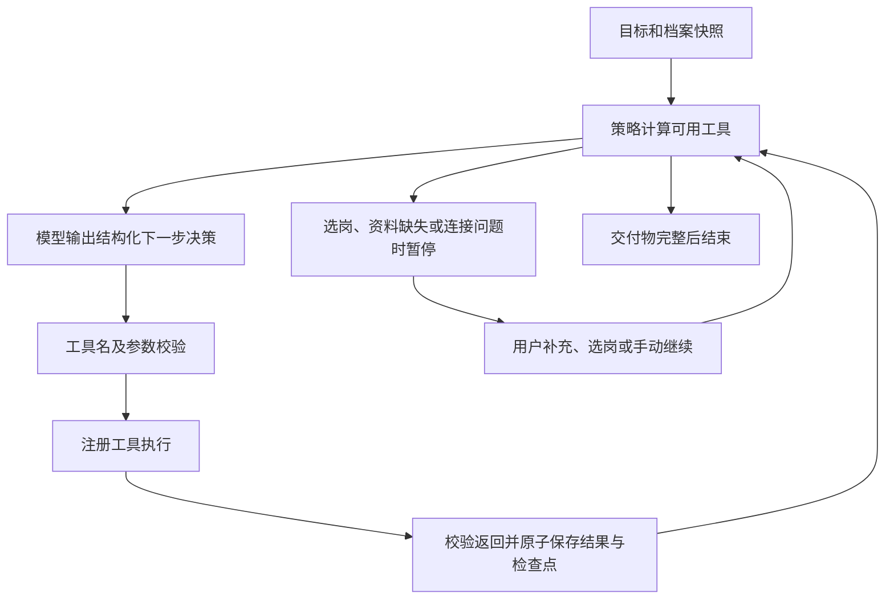

# 求职 Agent Harness

2026-10-27：入口仍为 http://127.0.0.1:18743/ ，左侧“求职 Agent”打开任务面板。服务端入口 `server.py`，新执行层 `agent_runtime.py`，旧 `harness.py` 继续为已有任务提供兼容执行。

## 执行结构

Harness 管执行状态、前置条件、模型决策边界、预算、工具适配器、结果来源、检查点、暂停恢复及取消。模型只能输出已注册且当前允许的工具，不能执行任意 shell、HTTP 或外部写操作；也可以通过 human.request_input 请求必要信息。只有档案预检由本地直接执行，其余步骤由模型返回 JSON 决策，服务端再次校验。依赖条件由代码约束，模型不能跳过JD来源校验、个人资料发送同意或用户选岗。

## 已接通的能力

- 本机 Codex CLI 模型适配器：目标决策、逐项匹配、简历草稿生成；沿用已配置的模型认证。
- BOSS 网页接口工具：status、search、detail。状态查询调用页面账号接口；只有实际在线查询成功才作为查询可用证据。页面接口返回错误、风控、验证码或不明确结果时立即暂停，不自动循环重试。
- 本地资料：创建时复制真实经历、求职偏好、目标、搜索条件和已有JD。不会把聊天消息自动当作已授权工具动作。
- SQLite：任务状态、结构化决策、每步结果、检查点、尝试计数、处理中调用标记、选岗记录和trace IDs。每个成功工具只在结果及检查点一起写入后视为完成。
- Markdown交付物：来源、JD指纹、匹配报告、可选简历草稿。运行台可以预览并下载；新草稿尚未自动写入原有Word简历台账。
- Langfuse：决策、模型、工具、输入输出与错误追踪，保留既有脱敏和增量上报。

## 两种目标任务

1. 在线找岗位：预检档案 → 模型决策 → 页面账号接口登录检查 → 实际搜索最多10个岗位 → 等待用户选岗 → 再核验登录状态 → 读取该岗位完整JD → 来源校验 → 匹配 → 按交付类型生成草稿 → 保存。
2. 已录入JD：预检档案 → 模型决策 → 校验BOSS链接与JD → 匹配 → 按交付类型生成草稿 → 保存。来源明确标记user_import，不声称在线采集。

工具执行以模型决策与已返回证据推进，但必须遵守上述前置条件；并非任意开放式探索。目标输入不会替代明确的城市和关键词筛选字段。每个任务处理一个用户选定岗位；需要其他岗位时创建新任务。

## 暂停、恢复与预算

状态包括 ready、running、waiting_input、waiting_selection、waiting_connection、failed、interrupted、budget_exceeded、cancelled、completed。

选岗只允许使用该任务真实搜索结果中的job_id。普通继续复用已完成结果；在线任务继续时重新检查本地登录状态。更新输入会清空失效结果、选岗和旧预算，从头验证。完整任务和已取消任务不重复执行。

每任务最多16个成功工具检查点、24次模型决策与工具尝试之和、同一工具最多3次尝试；无自动重试。模型调用240秒超时，页面接口25秒超时。服务重启将running标为interrupted，手动继续时只重放尚未确认完成的只读或本地步骤。取消后不再提交返回结果，但不能立即终止已发出的CLI请求。运行中不允许更新输入。

新任务不提供联系招聘方、投递附件、绕过验证码、浏览器自动操作工具。现有简历台账确认操作仍只形成waiting_browser请求，不能宣称已发送。模型简历为草稿，必须人工核对事实。

## API

- GET /api/harness：任务列表、工具Schema、能力边界。旧记录仍展示为旧版顺序工作流。
- POST /api/harness：create（mode=boss或jd）、resume、select（job_id）、update、cancel。沿用X-App-Token认证。
- GET /api/harness/artifact/{id}：仅可下载completed任务交付物。
- context字段：resume、preferences、jd、jobtitle、joburl、goal、query、city、deliverable（analysis或resume）。consent必须为布尔true才允许发送模型。

运行页不展示账号凭据。任务库权限600，目录700。简历、JD及工具输出属于个人工作区数据，追踪脱敏规则见LANGFUSE.md。

## 验证

`python3 -m unittest discover -s tests -v`

包含旧版本兼容测试，以及新运行循环的完整任务、真实结果选岗、来源不匹配拦截、未同意不发送模型、越权工具/参数拦截、连接错误停止、取消丢弃结果、重启恢复、预算和交付类型测试。

开发验收证据位于data/agent-verification。真实模型验收只使用明确标记为虚构的工程样例，不搜索真实岗位、不发送消息、不投递。结果以live-result.json为准；UI使用真实本地服务验证桌面和手机视口。

最终验收：41项测试通过；真实模型样例任务 341bf916fb0345dca71f503444d148c7 状态 completed，4个检查点，Langfuse trace 70dcb7502f4b4f7c821437dd28886479。此前MCP本地状态检查返回已登录（该适配器现已移除），未为工程验收发起真实岗位搜索。桌面/手机UI无JavaScript异常。

## 2026-10-29 对话接入修复

`chat_workflows.py` 将对话意图接到真实 Harness：支持创建、查询进度、继续、选岗、更新输入与停止。任务关联保存在 Harness SQLite 的 chat_runs 表，按会话隔离；只允许操作当前会话关联的真实任务及候选岗位。解释工作流原理不创建任务。缺少档案或连接时由 Harness 保留暂停原因，聊天不虚构完成状态。

对话示例：“启动工作流，寻找深圳 AI 测试岗位并在选岗后生成简历草稿”“查看任务进度”“继续刚才的任务”“停止任务”。生成任务的聊天消息提供“查看 Harness 任务”按钮。普通聊天仅使用近期对话和按需读取的档案、技能、台账，不再每次注入完整技能与历史岗位库。网页版传递 conversation_id，原生客户端保留 workflow_id。

真实模型隔离验收记录：data/chat-repair-verification/live-result.json。普通聊天、上下文记忆、通过聊天创建虚构JD样例分析任务、完成4个检查点并保存报告、再次通过聊天查询完成状态均通过。未为此次验收搜索真实岗位或联系招聘方。更新后的本机客户端已实际发送普通测试消息并收到真实回复，trace a5deea6d9e8348b3b65c8e80c7aedc43。

## 2026-10-30 统一语义意图与工具路由

对话入口现在固定为：消息及近期上下文 → `IntentRouter.plan` → 严格Schema校验 → 对应工具执行 → 依据真实工具结果返回。移除了简历查询关键词预判、Harness关键词预判和BOSS关键词预判；每条消息均进入同一个语义路由入口。Harness接收已经校验的动作，不再重复进行意图分类；BOSS适配器仅在语义路由明确选择线上查询后运行其受限查询循环。

路由工具目录包含 `chat.respond`、`clarify`、`resume.list`、`jobs.list`、`profile.read`、`tracking.status`、`boss.query`、`harness`。模型只提议工具名和结构化参数，后端决定执行。未注册工具、额外参数、非法日期、错误枚举、其他会话任务ID及不存在的候选岗位均不能直接执行。模型路由超时上限40秒，失败不回退到原来的240秒长回答，也不启动工具。

简历查询参数区分日期、created/reviewed/screened口径、original/tailored类型和审阅状态。岗位查询区分首次入库时间与筛选完成时间。缺少筛选完成时间时明确返回不支持的统计口径并澄清，禁止拿入库时间替代。日期统一使用Asia/Shanghai；审阅时间按reviewed_at，已审阅还需当前文件哈希与确认版本一致。追问“那昨天呢”由近期对话语义继承对象和条件。

普通问候、解释概念由同一次路由返回简短正文；本地清单读取后直接依据记录返回，不额外让模型重构事实。实时进度仍使用已有单行状态，新增intent.route节点，追踪中保存结构化路由与工具实际结果。

## 岗位查询与筛选 Skill

新增 `skills/job-search-screening/SKILL.md`，在助手“已安装技能”中展示为“岗位查询与筛选”，支持自动选择和 `@job-search-screening` 显式调用。语义路由先读取Skill目录元数据；选择skill.run后，`assistant_skills.SkillRuntime`读取本机SKILL.md，再将正文提供给模型生成实际工具计划。模型只看过目录时不视为已执行Skill。

新Skill可选择jobs.list、boss.query、harness、clarify或chat.respond；不能扩大后端注册工具权限、递归加载Skill或把其他会话任务当作当前任务。Skill实际加载产生skill.load追踪和SHA256，响应skills_used包含加载的ID与指纹。普通聊天和无关的简历文件查询可沿用直接工具路由。

## 岗位生命周期状态查询

新增只读语义工具`jobs.status`，与`job-search-screening` Skill一起支持按公司/岗位/城市以及组合状态查询。维度包括打招呼、HR回复、定制简历、有效本人审阅、简历发送、面试、结果、匹配筛选、JD、匹配分析、草稿审阅流程、关联简历类型与待办状态。跨维度AND、同维度数组OR；待办类型和状态必须命中同一记录。

工具聚合岗位历史库、Tracker、简历版本和全部待办元数据，响应包含逐岗标签、关联版本、状态分布、时间字段以及可选最近20条脱敏历史。缺失状态按未知处理；默认初始状态不视为远端实时核验。无HR简历初筛结果字段，因此不允许推断HR通过；“通过简历”先澄清本人审阅还是招聘方初筛。有效本人审阅要求当前版本指纹与审阅指纹一致。

日期口径独立：首次入库、当前沟通/面试状态最近记录时间、定制版本保存时间、有效审阅时间；不使用updated_at代替缺失时间。接口`POST /api/job-status`及`GET /api/job-status/schema`受X-App-Token保护，与聊天共用查询函数，不调用模型、不修改状态、不触发发送或定制。

真实模型隔离验证：data/chat-repair-verification/status-live-result.json，6项包含组合沟通条件、逐公司全部状态、定制待审阅、简历通过歧义、Offer与当天面试。工程样例不联系招聘方。

## 长输入传输导致的模型规划超时修复

复现trace f6fab2eef3be4ab1a26098e662086fdb：加载Skill后的提示词18,142字节，通过原可取消执行封装时40秒超时；同一提示词直接subprocess.run约8秒返回。当前Python的_communicate在input参数为空时不再注册stdin写事件；原封装每0.1秒超时后以input=None重入，子进程若未及时读取完长输入，余下提示词就永远不再写入且stdin保持打开。

execution_control.managed_run改为专用IO线程只调用一次communicate，发送完整输入并排空输出；拥有者线程只负责检查停止与总超时。取消或超时会终止、回收进程组并释放管道，不并发调用communicate。新增延迟0.35秒读取大量中文输入、校验完整输入哈希与大stderr，以及输入阻塞时取消的回归。

同一失败提示词在修复后的受控执行中9.23秒返回正确jobs.status计划；155项回归通过。证据：data/chat-repair-verification/stdin-fix-result.json。
