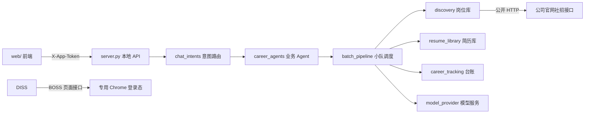

# 向前 · 求职助手（Career Assistant）

> 一个本地优先的求职 Agent 工作台：把"找岗位 → 读 JD → 匹配筛选 → 打招呼 → 定制简历 → 回复跟进 → 投递核验"串成一条可审计、可暂停恢复的自动化流水线。

本仓库是「向前 · 求职助手」的源码（不含任何个人数据、登录态或第三方体积较大的技能包）。

## 特点

- **多 Agent 小队**：`collect`（岗位采集）/ `match`（匹配筛选）/ `greet`（沟通）/ `tailor`（简历定制）/ `deliver`（投递）/ `followup`（回复跟进）/ `interview`（面试管理），每个 Agent 都有明确的前置条件和写入边界。
- **双重岗位来源**：
  - BOSS 直聘「综合推荐 / 关键词搜索」：复用专用 Chrome 的登录态，经页面同源接口只读查询；
  - 官网社招：腾讯、字节、阿里、百度、美团、蚂蚁、滴滴、京东等公司官网公开接口，无需登录。
- **本地优先**：所有岗位、聊天、简历、投递记录都落在本机 SQLite；服务只监听 `127.0.0.1`。
- **可暂停 / 可恢复 / 有预算**：每步工具调用都有检查点；配置错误、验证码、登录失效时立即停下并如实说明，不静默重试、不伪造完成。
- **幻觉防护**：匹配/定制只基于真实 JD 与真实简历；简历改写保留原文事实，不编造单位、日期、学历或数字；未审阅的版本不能触发投递。
- **语义意图路由**：对话入口统一走「模型提议工具 → 严格 Schema 校验 → 后端执行 → 按真实结果回答」，模型不能越权执行未注册工具。

## 架构



- 运行层：`server.py`（标准库 `http.server`），`agent_runtime.py`（目标-工具-观察-检查点）、`batch_pipeline.py`（小队调度）、`career_agents.py`（Agent 注册与子任务持久化）。
- 数据层：`discovery.py`（岗位库，按 `platform` 隔离 BOSS / 官网）、`resume_library.py`（简历版本）、`career_tracking.py`（投递台账）。
- 页面适配：`boss_web.py`（Chrome DevTools Protocol 同源 fetch）、`official_careers.py`（官网公开接口）。
- 前端：`web/`（原生 HTML/CSS/JS，无构建步骤）。

## 技术栈

- Python 3.12（标准库 `http.server` / `sqlite3` / `urllib`）
- `websocket-client`（Chrome DevTools Protocol）
- `python-docx`（简历 Word 生成/改写）
- 原生 JavaScript + CSS（`web/`）
- 模型：DeepSeek Chat Completions（OpenAI 兼容端点），可通过环境变量切换

## 快速开始

```bash
# 1. 安装依赖（建议虚拟环境）
python3 -m venv .venv && source .venv/bin/activate
pip install -r requirements.txt

# 2. 配置模型（任选其一）
export DEEPSEEK_API_KEY=sk-...
# 或写入 ~/.zshrc 等 profile（model_provider.py 会自动读取）

# 3. 启动本地服务
python server.py
# 打开 http://127.0.0.1:18743
```

> BOSS 相关功能需要一个专用 Chrome 窗口：首次使用在页面点「打开 BOSS 登录窗口」，完成登录后即可查询；本程序不导出 Cookie、不绕过验证码。

## 目录结构

```
server.py                 # 本地 HTTP API + 前端托管 + 意图路由入口
agent_runtime.py          # 目标驱动的 Agent 运行器（检查点/暂停/预算）
batch_pipeline.py         # 推荐小队：采集/读JD/匹配/招呼/定制/投递的调度
career_agents.py          # 7 个业务 Agent 的注册、子任务与汇报
chat_intents.py           # 语义意图路由 + 严格 Schema 校验
discovery.py              # 岗位库（SQLite，按平台隔离）
official_careers.py       # 公司官网社招适配器（公开 HTTP）
boss_web.py               # BOSS 页面同源接口（CDP）
resume_*.py               # 简历版本、定制、投递
job_*.py                  # 岗位状态聚合与台账看板
model_provider.py         # 模型调用（DeepSeek / 可切换）
web/                      # 前端
skills/                   # 技能说明（SKILL.md）与脚本
tests/                    # 单元/接口/回归测试
data/                     # 运行时数据（.gitignore，不入库）
```

## 测试

```bash
python3 -m unittest discover -s tests -v
```

覆盖：意图路由、Schema 校验、小队状态机、简历定制、投递前置条件、HTTP 接口、官网适配器、检查点恢复等。

## 数据与隐私

- `data/`、`jobs/`、`releases/`、`rendered-*` 等运行时目录**不会进入仓库**（见 `.gitignore`），其中可能包含登录态、聊天记录和简历等个人信息。
- 服务默认只监听 `127.0.0.1`，所有写操作都受 `X-App-Token` 校验。
- 模型请求仅在用户明确同意（`consent=true`）时发送简历与 JD 文本。

## 部署说明

本项目依赖「本机登录的 BOSS 会话」和「本地 SQLite」，**完整功能不适合直接公网部署**。可选的部署方式：

- **在线 Demo**：<https://guo442.github.io/atoms-career-assistant/> —— `docs/` 目录复用真实前端 UI（`web/` 的 HTML/CSS/JS）+ 一个拦截 `/api/*` 的 Mock 脚本，静态托管即可打开，界面与本地客户端一致。
- **自托管**：在能访问 BOSS 的设备上按「快速开始」运行即可；如需公网访问，请自行加反向代理与鉴权，并注意个人信息合规。

## License

代码仅供学习与求职演示使用，不含第三方受限内容。
